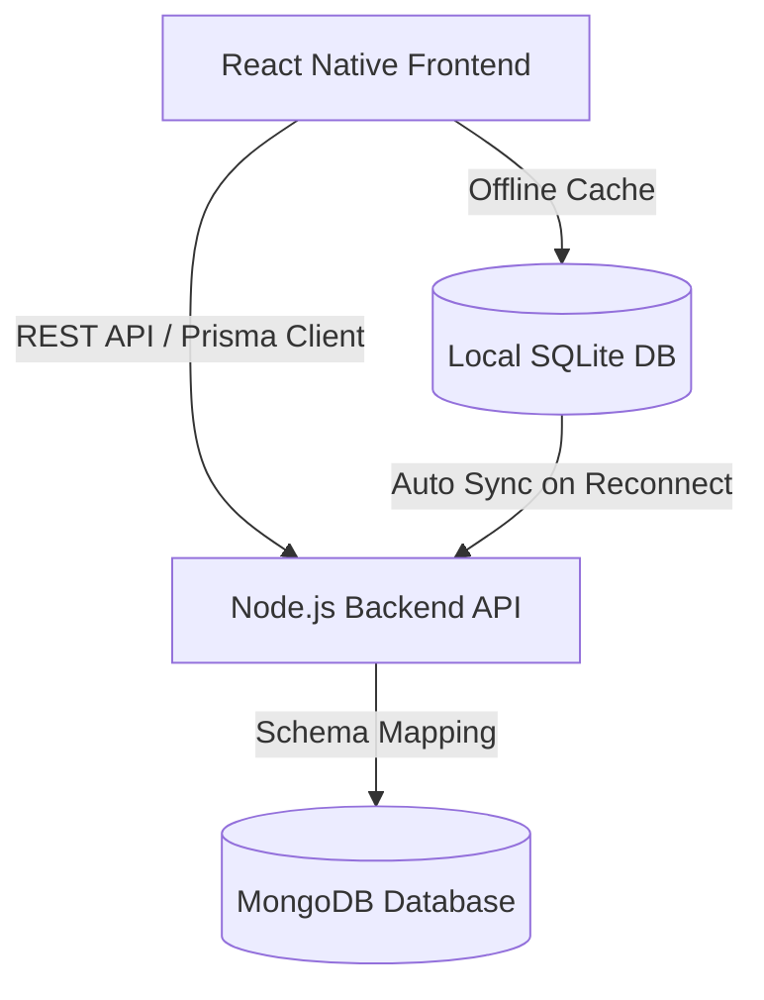

# Course Coverage Report (CCR) Management System
### Jaya Engineering College (JEC)
*Department of Computer Science & Engineering (CSE)*

---

## 1. Project Overview
The **Course Coverage Report (CCR) Management System** is a mobile and web-based application designed to automate, streamline, and digitize the tracking of academic syllabus coverage, weekly teaching hours, and progress logs.

Traditionally, tracking syllabus progress is a manual, paper-heavy, or fragmented process where class coordinators compile individual excel files from multiple faculty members and report them to the Head of the Department (HOD) and the Principal. The CCR application centralizes this workflow, allowing real-time entries, consolidated automatic reporting, offline logging, and administrative approval chains.

---

## 2. Core Problems Solved
* **Time-Consuming Consolidation:** Automates the task of class coordinators physically compiling course coverage sheets from various subject teachers every week.
* **Lack of Real-time Visibility:** Provides the HOD and the Principal with instant dashboards showing which portions of the Anna University syllabus are covered versus what is pending.
* **Loss of Progress Logs Offline:** Faculty often teach in class zones with poor internet connectivity. The application addresses this by supporting robust offline progress tracking.
* **Intellectual Property Protection:** Implements private deployment strategies to prevent competing institutions from copying the application flow or academic workflows.

---

## 3. Key System Features
* **Automated Weekly Spreadsheets:** Generates clear grids containing course codes, course names, assigned faculty, completed contact hours, topics covered, schedule status (Yes/No), reasons for delays, and extra hours requested.
* **Offline-First Capabilities:** Allows faculty to record class logs and verify syllabus details locally on their device, which then automatically syncs with the central server once internet connectivity is restored.
* **Domain-Restricted Authentication:** Restricts login and registration to official college email accounts (`@jec.com`) to protect institutional data.
* **Role-Based Dynamic Dashboards:** Tailors views, permissions, and tools based on the user's academic position.
* **Multi-Format Export:** Supports generating and downloading weekly reports as PDFs directly from the dashboard.

---

## 4. User Roles & Workflows

### A. Subject Teacher / Staff
* **Input logs:** Enter the number of hours taught during the week and select covered topics (from pre-loaded syllabus databases like *CS8501 - Theory of Computation* or *CS8502 - Database Management Systems*).
* **Deficit Reporting:** Flag when a topic is pending, state reasons for delay, and request extra hours to stay on schedule.

### B. Class Coordinator / Counselor (e.g., CSE-B Counselor)
* **Consolidation:** Reviews the auto-consolidated spreadsheet of all subjects assigned to that class section (e.g., III Year / V Semester - Section B).
* **Adding Remarks:** Appends coordinator remarks summarizing the overall academic week.
* **HOD Submission:** Submits the consolidated spreadsheet to the HOD for review.

### C. Head of Department (HOD - CSE)
* **Department Review:** Evaluates weekly reports across all class sections and years under the CSE department.
* **Feedback Loops:** Approves or flags reports, adding critical decisions/remarks that flow back to the coordinator and subject teachers.

### D. Principal
* **Institutional Dashboards:** Views high-level summaries of all departments (CSE, CSBS, etc.).
* **Compliance Checking:** Monitors general curriculum progress and exports weekly PDFs for institutional archiving.

---

## 5. Technical Architecture & Stack

* **Frontend:** Built with **React Native** and **TypeScript**, styled with a premium palette featuring Navy Blue (`#0B41CD`) and charcoal body fonts. The interface is optimized for rapid data entry with minimal scrolling.
* **Backend:** Scalable REST API built with **Node.js** and **Express**.
* **Database:** **MongoDB** (Cloud Database) mapped using **Prisma ORM** for primary storage, with a lightweight **SQLite** database on faculty mobile devices for local offline progress validation.
* **Security:** Secured using JWT tokens, domain validation (`@jec.com`), and role-based route protection.

---

## 6. Secure Distribution & Deployment
To protect the proprietary design of the system, the application is deployed through private networks rather than open public app stores:
1. **Managed Google Play (Private Apps):** Bound exclusively to the `@jec.com` Google Workspace domain so only verified college accounts can install it.
2. **Apple School Manager (Custom Apps):** Distributed privately to Jaya Engineering College devices via unlisted redemption codes.
3. **Self-Hosted JEC Portal:** Hosted on an internal college server behind an authentication firewall restricting access to local campus Wi-Fi.
