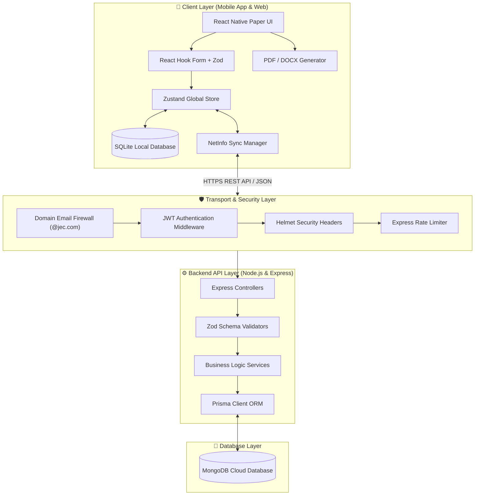
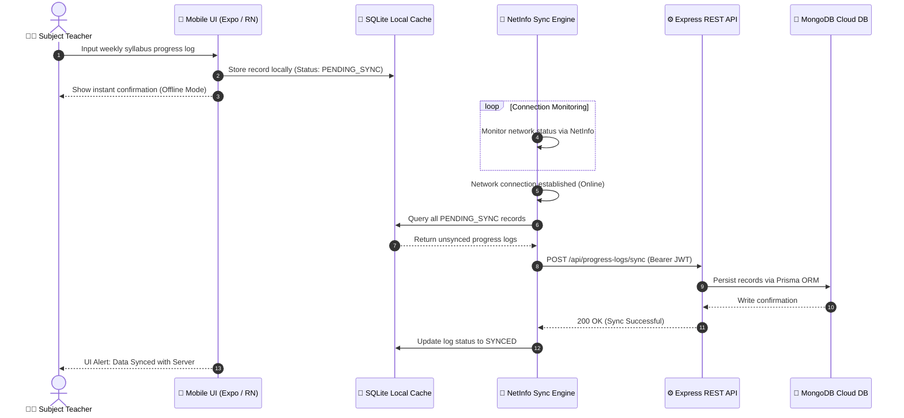
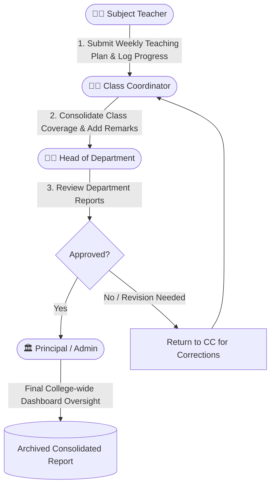
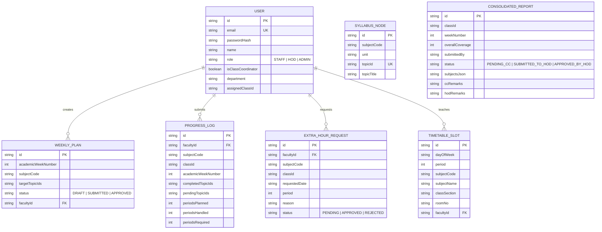

# 📐 Course Coverage Report (CCR) System Architecture Diagrams

This document contains the system architecture diagrams, data flow models, approval pipeline workflows, and entity-relationship diagrams (ERD) for the **Course Coverage Report (CCR) Management System** at **Jaya Engineering College**.

---

## 🏛️ 1. High-Level System Architecture Diagram

The system operates on an **Offline-First Client-Server Architecture** connecting mobile Expo/React Native clients with an Express REST API backend and a cloud MongoDB database.

---

## 🔄 2. Offline-First Synchronization Sequence Diagram

Logs recorded by faculty without active network connectivity are cached locally in SQLite and synchronized automatically once network connectivity is restored.

---

## 👥 3. Multi-Tier Role Approval Workflow Diagram

---

## 🗄️ 4. Database Entity-Relationship Diagram (ERD)

Target database schema defined in `backend/prisma/schema.prisma` targeting MongoDB:

---

## 🛠️ 5. Architectural Tech Stack Summary

* **Frontend:** React Native (`0.86`), Expo (`57`), TypeScript (`6.0`), Zustand (`5.0`), React Native Paper (`5.15`), SQLite, `@react-native-community/netinfo`.
* **Backend:** Node.js (`v20+`), Express (`4.19`), Prisma ORM (`5.12`), Zod (`4.4`), JWT, bcryptjs, Helmet, Express Rate Limit.
* **Database:** MongoDB (Cloud cluster).
